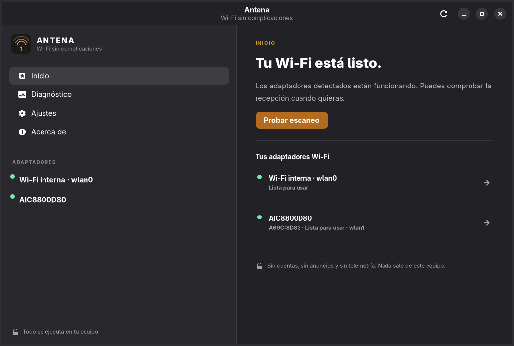
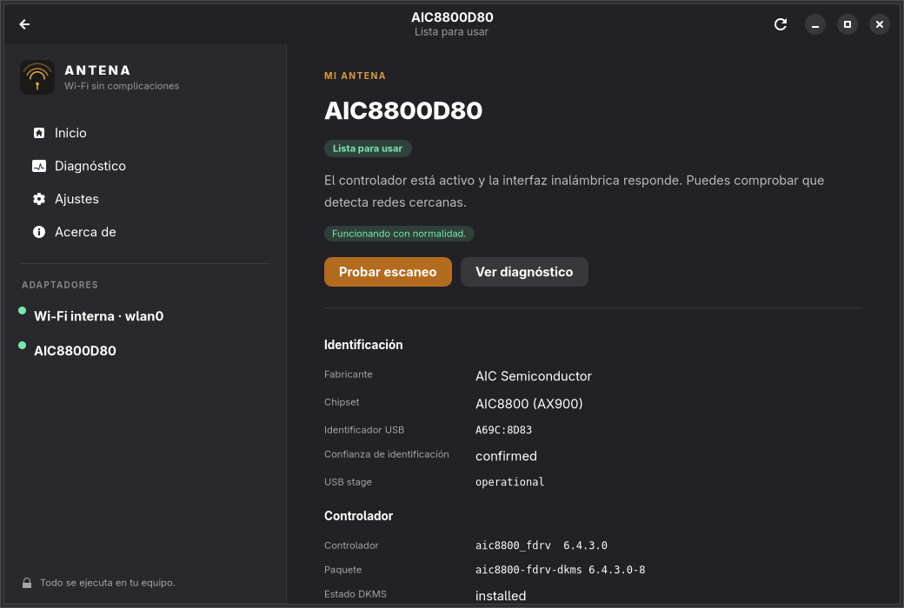
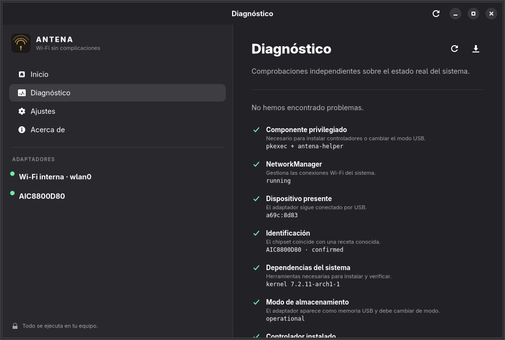
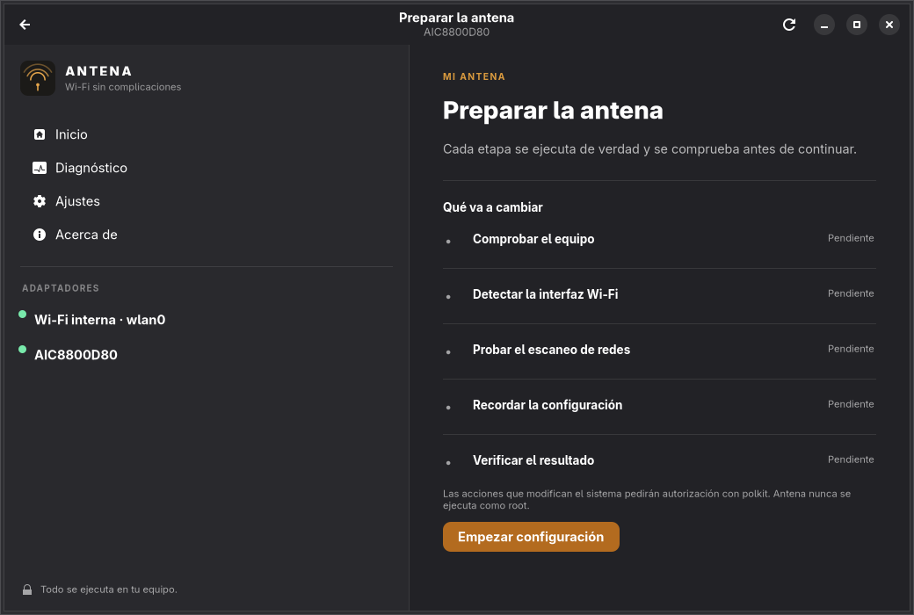
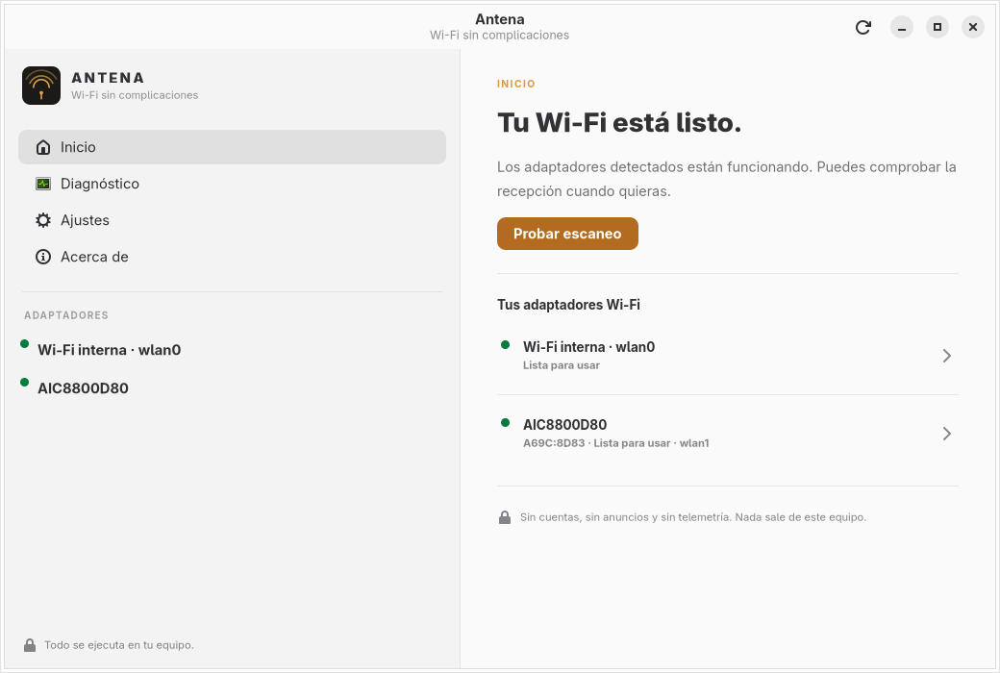

# Antena

**Configurar un adaptador Wi-Fi USB problemático en Arch Linux debería ser una
decisión, no una investigación.**

Antena detecta el hardware, identifica el chipset, explica qué falta y ejecuta
un plan de instalación con pasos reales y verificados. La interfaz se ejecuta
sin privilegios; solo un componente pequeño y auditables solicita autorización
a través de polkit.

> Estado: **0.1.0**, primera versión pública. Una receta de controlador está
> verificada con hardware real: **AIC8800D80 (AX900 Wi-Fi 6 USB)**. Varios
> controladores nativos del kernel se detectan y diagnostican, pero no se han
> probado físicamente con Antena. Todo lo demás se muestra como no compatible,
> sin inventar soporte.

## Capturas

| Inicio | Mi antena | Diagnóstico |
|---|---|---|
|  |  |  |

| Asistente | Tema claro |
|---|---|
|  |  |

Las capturas no incluyen SSID ni datos de conexión. La prueba de escaneo real
se ejecutó, pero su captura se excluyó por privacidad.

Las capturas se tomaron ejecutando la aplicación real sobre un equipo Arch con
el AIC8800D80 conectado. No son maquetas.

## Qué hace

- Detecta adaptadores USB y tarjetas internas leyendo `sysfs`, `udev`,
  NetworkManager, `iw`, `rfkill`, `modinfo`, DKMS y `pacman`.
- Distingue con claridad: dispositivo USB, chipset, controlador disponible,
  controlador cargado, interfaz inalámbrica, escaneo confirmado y conectividad.
- Identifica el AIC8800D80 en sus tres etapas USB:
  - `1111:1111` almacenamiento (requiere cambio de modo),
  - `a69c:8d80` transición,
  - `a69c:8d83` operativo.
- Instala el controlador DKMS solo desde una fuente **fijada por SHA-256** y
  después de comprobar la identidad real del dispositivo.
- Comprueba el resultado de cada etapa: módulo, interfaz, escaneo real con
  NetworkManager y estado final.
- Ofrece diagnóstico independiente con acciones concretas: rfkill,
  NetworkManager, encabezados, DKMS, firmware, conflictos, modo USB.
- Exporta un informe técnico sin contraseñas ni SSID guardados.
- Interfaz GTK4/libadwaita en español e inglés, modo claro y oscuro, pensada
  para 1366×768 y Wayland (probada en Niri).

## Qué no hace

- No instala controladores de chipsets desconocidos ni prueba recetas de otros
  modelos.
- No anuncia inyección de paquetes: **no está verificada** en el AIC8800D80.
- No captura contraseñas, no hace deautenticaciones ni funciones ofensivas.
- No envía datos a Internet. Las únicas conexiones salientes posibles son la
  descarga del controlador que autorices (URL y hash del catálogo).
- No ejecuta `curl | bash`, no usa `shell=True` y no acepta comandos desde la
  interfaz.
- No desactiva Secure Boot, no toca `SigLevel = TrustAll` y no elimina
  controladores de terceros durante la desinstalación.

## Compatibilidad

| Dispositivo / chipset | Detección | Controlador | Estado verificado |
|---|---|---|---|
| AIC8800D80 / 88M80 (AX900) | Completa, 3 etapas USB | DKMS 6.4.3.0 con hash fijado | **Sí**, hardware real: 2,4/5 GHz, modo monitor y Beacons pasivos |
| Atheros AR9271 (`ath9k_htc`) | Por USB ID y driver | Kernel + `linux-firmware` | No probado físicamente por Antena |
| Ralink RT5370 (`rt2800usb`) | Por USB ID y driver | Kernel + `linux-firmware` | No probado físicamente por Antena |
| MediaTek MT7601U | Por USB ID y driver | Kernel + `linux-firmware` | No probado físicamente por Antena |
| MediaTek MT7921AU | Por USB ID y driver | Kernel + `linux-firmware` | No probado físicamente por Antena |
| Realtek RTL8188EU/8192EU (`rtl8xxxu`) | Por USB ID y driver | Kernel + `linux-firmware` | No probado físicamente por Antena |
| Intel Wi-Fi PCI (`iwlwifi`) | Por driver e interfaz | Kernel + `linux-firmware` | No probado físicamente por Antena |
| Cualquier otro | Diagnóstico de solo lectura | — | **No compatible / sin receta** |

La tabla no es una promesa de compatibilidad. Una receta con controlador nativo
significa que Antena reconoce el chipset y comprueba su estado; no significa que
se haya validado ese modelo concreto. Consulta `docs/DRIVERS.md`.

## Instalación

Requisitos: Arch Linux o derivados (EndeavourOS, CachyOS…), `base-devel` y las
dependencias del paquete (`gtk4`, `libadwaita`, `python-gobject`,
`networkmanager`, `polkit`, `usb_modeswitch`, `dkms`, `iw`).

```bash
git clone https://github.com/USUARIO/antena-arch
cd antena-arch
./install.sh
```

> `USUARIO` es un marcador deliberado. Sustitúyelo por la URL real cuando el
> repositorio esté publicado. No se ha publicado nada en AUR.

El instalador **no** se ejecuta como root: construye con `makepkg` como tu
usuario y luego llama a `sudo pacman -U`. `install.sh` comprueba `base-devel`,
las dependencias y explica el comando exacto si falta algo.

AUR (objetivo futuro, **no disponible todavía**):

```bash
yay -S antena-arch
```

Desinstalación gestionada:

```bash
sudo pacman -Rns antena-arch
```

`pre_remove` retira solo las reglas de udev y módulos-load que creó Antena. No
elimina el controlador DKMS de terceros ni paquetes instalados previamente. Si
Antena instaló su propio controlador, la retirada exige una acción explícita:

```bash
printf '%s\n' '{"remove_driver": true}' | sudo /usr/lib/antena/antena-helper cleanup
```

## Uso

1. Abre **Antena**.
2. Conecta la antena USB. En **Inicio** aparecerá con su estado real.
3. Si necesita configuración, pulsa **Configurar mi antena**.
4. Revisa las etapas y autoriza con polkit.
5. Cuando termine, usa **Probar escaneo** para verificar la recepción real.

También hay CLI para equipos sin sesión gráfica o para soporte:

```bash
antena --detect          # detección legible
antena --diagnose        # diagnóstico con códigos de estado
antena --scan            # escaneo real y lista de redes
antena --json --report /tmp/antena.json
antena --version
```

## Seguridad y privacidad

- La GUI corre como tu usuario. Ninguna operación privilegiada se ejecuta
  dentro del proceso gráfico.
- El helper `/usr/lib/antena/antena-helper` se invoca con `pkexec`, recibe un
  nombre de operación cerrado y un JSON validado por `stdin`, y vuelve a
  comprobar el dispositivo real antes de modificarlo.
- Lista cerrada de paquetes y módulos permitidos; los mensajes de
  `usb_modeswitch` solo salen del catálogo root-owned.
- El controlador se descarga por HTTPS, se verifica su tamaño y SHA-256, se
  extrae con protección contra rutas maliciosas y se registra cada archivo
  creado en `/var/lib/antena/state.json`.
- La persistencia usa una regla udev específica (VID/PID + fabricante +
  producto), no una regla genérica por VID/PID.
- No hay cuentas, anuncios, analítica ni telemetría. Los informes se guardan
  localmente y no incluyen contraseñas Wi-Fi.

Más detalle: [`SECURITY.md`](SECURITY.md) y
[`docs/ARCHITECTURE.md`](docs/ARCHITECTURE.md).

## Pruebas

```bash
python -m venv .venv --system-site-packages
.venv/bin/pip install pytest
.venv/bin/pytest -q
```

La suite contiene **52 pruebas** con un árbol `sysfs` simulado y un runner de
comandos falso. Cubre los 20 escenarios exigidos en el diseño: ausencia de
antenas, una o dos, las tres
etapas USB del AIC8800D80, DKMS correcto y fallido, kernel incompatible, falta
de red, cancelación de polkit, chipset desconocido, desconexión, instalación
repetida, NetworkManager no gestionado, conflictos, Wi-Fi interna intacta,
modo monitor anunciado pero no verificado, reconexión y desinstalación segura.

**Simulación no es hardware.** Durante el desarrollo se ejecutaron además
pruebas reales de detección, diagnóstico y escaneo sobre el AIC8800D80
conectado. No se ejecutó el cambio de modo real, la instalación del controlador
ni la prueba de modo monitor para no alterar un adaptador que ya funcionaba.
Ver [`docs/TROUBLESHOOTING.md`](docs/TROUBLESHOOTING.md) y el estado de
limitaciones más abajo.

## Limitaciones conocidas (0.1.0)

- Solo el AIC8800D80 tiene una receta de instalación **verificada con hardware**.
- La ruta de instalación DKMS con hash está implementada y probada con
  simulaciones; en el equipo de desarrollo el controlador ya estaba instalado.
- El cambio de modo USB se implementó con los mensajes exactos verificados en
  la prueba original, pero Antena no lo ejecutó de nuevo durante esta sesión.
- La persistencia udev está implementada y cubierta por pruebas, pero no se
  instaló en el equipo de desarrollo para no modificar un arranque funcional.
- La prueba pasiva de modo monitor (tcpdump + pcap) está implementada; requiere
  `tcpdump` y autorización, y no se ejecutó en esta sesión.
- La inyección de paquetes no está soportada ni verificada.
- Con Secure Boot activo, un módulo DKMS sin firma puede no cargar. Antena no
  desactiva Secure Boot ni modifica el firmware; el usuario debe enrolar la
  clave MOK según su distribución si decide usar ese controlador.
- El paquete AUR no está publicado. `packaging/PKGBUILD.aur` es una plantilla.
- La URL del repositorio y el metadato `url` son marcadores hasta publicar.

## Contribuir

Lee [`CONTRIBUTING.md`](CONTRIBUTING.md) y
[`docs/ADDING_DEVICES.md`](docs/ADDING_DEVICES.md). Una receta nueva exige
evidencia en hardware real, fuente y licencia del controlador, hash si hay
descarga, y pruebas de los estados de error.

## Licencia

Código propio: **GPL-3.0-or-later**. Los controladores de terceros no se
redistribuyen; se descargan desde su origen con licencia y hash documentados en
el catálogo. Consulta [`docs/DRIVERS.md`](docs/DRIVERS.md).

---

## English summary

Antena is a GTK4/libadwaita app for Arch Linux that detects USB Wi-Fi adapters,
explains what is missing and runs verified setup steps. The AIC8800D80 (AX900)
recipe is verified on real hardware; several in-kernel drivers are detected and
diagnosed but not physically tested by Antena. It does not claim support for
unknown chipsets. Privileged work is isolated in a small pkexec helper with a
closed operation allowlist. No accounts, ads or telemetry. AUR is not published
yet. See the Spanish sections above for details and limitations.
